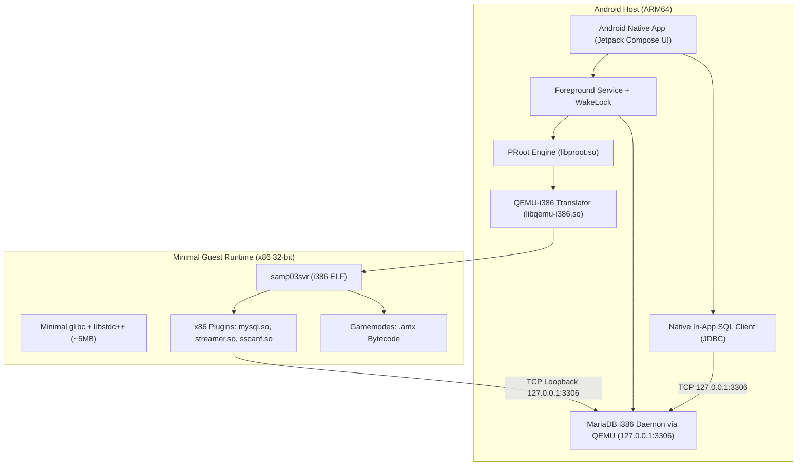

# PocketSAMP 🚗💨
> **Standalone, No-Root Portable SA-MP 0.3.7 Server & MariaDB MySQL Runtime for Android (ARM64)**

PocketSAMP allows developers and community server owners to run a legacy **GTA San Andreas Multiplayer (SA-MP 0.3.7)** server and its associated **MySQL/MariaDB database** directly on an unrooted Android device.

---

## 🏗️ Architecture & How It Works

Modern Android devices run on **64-bit ARM (`aarch64`)**, while the legacy official SA-MP server binary (`samp03svr`) is a **closed-source 32-bit Linux x86 (`i686`)** executable.

PocketSAMP bridges this architecture gap without requiring root or heavy virtual machines:



### Key Technical Pillars:
1. **CPU Emulation via QEMU User-Mode:** `libqemu-i386.so` translates x86 32-bit instructions into native ARM64 instructions at userland level.
2. **Filesystem Sandboxing via PRoot:** `libproot.so` intercepts system calls and binds `/dev`, `/proc`, and internal app storage without needing `su` / root.
3. **Ultra-Low Memory Footprint (~150 MB Total RAM):**
   - Instead of heavy XAMPP stacks (Apache + PHP + MySQL default = 600MB+), MariaDB runs as an i386 build under the same QEMU translator as the game server, with `innodb_buffer_pool_size = 16M` and `performance_schema = OFF`.
   - The in-app database manager connects directly over TCP loopback, eliminating the need for a web server or phpMyAdmin.
4. **Android Power Management Resilience:** Runs within an Android Foreground Service using a `PartialWakeLock` and `WifiLock` to prevent CPU sleep and desync when the screen is locked.

---

## 📱 Features

- **One-Tap Server Controls:** Start, stop, and restart SA-MP and MariaDB concurrently.
- **Real-Time Terminal Console:** Live stream of SA-MP log entries and plugin outputs with search and share capabilities.
- **In-App Database Manager:**
  - View databases and tables.
  - Execute custom SQL queries.
  - One-tap `.sql` dump import from device storage.
- **Visual `server.cfg` Editor:** Edit hostname, rcon password, gamemodes, filterscripts, and plugins directly in the UI.
- **Local & LAN Multiplayer:** Display device IP so other players on the same Wi-Fi network or mobile hotspot can connect (`<LAN_IP>:7777`).

---

## 📂 Zero-Copy User-Managed Gamemode Directory

PocketSAMP reads your gamemode files directly from Android public shared storage without root or copying:
- **Default Directory:** `/storage/emulated/0/PocketSAMP/`
- **Custom Directory:** You can select ANY folder on your device containing your SA-MP server files via the in-app **"Pilih Folder"** picker on the Dashboard tab!

### Gamemode Structure (User Managed):
- **`server.cfg`**: Your server configuration file (loaded and executed directly by the server).
- **`gamemodes/`**: Place compiled `.amx` gamemodes here.
- **`filterscripts/`**: Place filterscript `.amx` files here.
- **`plugins/`**: Place x86 32-bit Linux plugins (`.so`) here.
- **`scriptfiles/`**: Place accounts, player data, configs, or sqlite databases here.
- **`server_log.txt`**: Live server output log.

No template files are forced into your directory. The server directly runs your gamemode and configuration in real time with 0.00s loading overhead.

---

## 🛠️ Building the Project

### Option A: Automated CI/CD (GitHub Actions)
Push this repository to GitHub. The included workflow `.github/workflows/build-apk.yml` will automatically build and publish the debug APK as an artifact.

### Option B: Local Android Studio
1. Open the project folder in **Android Studio Hedgehog / Jellyfish / Ladybug**.
2. Sync Project with Gradle Files.
3. Build -> **Build APK(s)**.

---

## 📜 License
- SA-MP binaries and sample gamemodes remain copyrighted by the SA-MP Team.
- PRoot is licensed under GPL-2.0.
- QEMU is licensed under GPL-2.0.
- MariaDB is licensed under GPL-2.0.

---

## 🗄️ MariaDB Asset Bundle
MariaDB is **not** a native ARM build. It ships as an ordinary **i386 Debian** build and
runs under the same `qemu-i386` translator as the SA-MP server, using the glibc already
present in `rootfs_i386`. There is no arm64 path and no on-device download: the bundle
is built in CI, committed under `app/src/main/assets/`, and extracted at first boot.

The runtime extracts `assets/mariadb_i386.tar(.gz)` into `filesDir/mariadb/`. The
archive must be **self-contained**:

```
bin/mariadbd
bin/mariadb-install-db
lib/            all shared objects mariadbd needs but the rootfs lacks
share/mariadb/  error messages (lc-messages-dir)
```

`rootfs_i386` provides only `libc`, `libm`, `libz`, `libgcc_s` and `libstdc++`. The
bundle must therefore carry the other eight entries of `mariadbd`'s `NEED` list:
`libcrypto.so.3`, `libssl.so.3`, `libpcre2-8.so.0`, `libaio.so.1`, `libnuma.so.1`,
`liburing.so.2`, `libsystemd.so.0`, `libcrypt.so.1`. The `MariaDB i386 Bundle` workflow
fetches them from the Debian i386 index, packs them and refuses to publish a bundle
when any `NEED` entry is missing.

If the daemon is absent the runtime logs a specific reason and keeps the database
service off. The SA-MP server still runs: database support is optional for
SQLite/file gamemodes.
