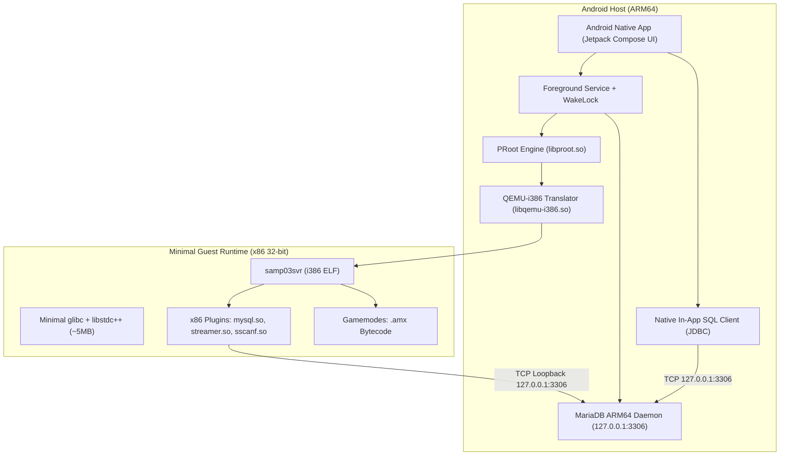

# PocketSAMP 🚗💨
> **Standalone, No-Root Portable SA-MP 0.3.7 Server & MariaDB MySQL Runtime for Android (ARM64)**

PocketSAMP allows developers and community server owners to run a legacy **GTA San Andreas Multiplayer (SA-MP 0.3.7)** server and its associated **MySQL/MariaDB database** directly on an unrooted Android device.

---

## 🏗️ Architecture & How It Works

Modern Android devices run on **64-bit ARM (`aarch64`)**, while the legacy official SA-MP server binary (`samp03svr`) is a **closed-source 32-bit Linux x86 (`i686`)** executable.

PocketSAMP bridges this architecture gap without requiring root or heavy virtual machines:



### Key Technical Pillars:
1. **CPU Emulation via QEMU User-Mode:** `libqemu-i386.so` translates x86 32-bit instructions into native ARM64 instructions at userland level.
2. **Filesystem Sandboxing via PRoot:** `libproot.so` intercepts system calls and binds `/dev`, `/proc`, and internal app storage without needing `su` / root.
3. **Ultra-Low Memory Footprint (~150 MB Total RAM):**
   - Instead of heavy XAMPP stacks (Apache + PHP + MySQL default = 600MB+), MariaDB runs natively on ARM64 with `innodb_buffer_pool_size = 16M` and `performance_schema = OFF`.
   - The in-app database manager connects directly over TCP loopback, eliminating the need for a web server or phpMyAdmin.
4. **Android Power Management Resilience:** Runs within an Android Foreground Service using a `PartialWakeLock` and `WifiLock` to prevent CPU sleep and desync when the screen is locked.

---

## 📱 Features

- **One-Tap Server Controls:** Start, stop, and restart SA-MP and MariaDB concurrently.
- **Real-Time Terminal Console:** Live stream of SA-MP log entries and plugin outputs with search and share capabilities.
- **In-App Database Manager:**
  - View databases and tables.
  - Execute custom SQL queries.
  - One-tap `.sql` dump import from device storage.
- **Visual `server.cfg` Editor:** Edit hostname, rcon password, gamemodes, filterscripts, and plugins directly in the UI.
- **Local & LAN Multiplayer:** Display device IP so other players on the same Wi-Fi network or mobile hotspot can connect (`<LAN_IP>:7777`).

---

## 📂 Zero-Copy User-Managed Gamemode Directory

PocketSAMP reads your gamemode files directly from Android public shared storage without root or copying:
- **Default Directory:** `/storage/emulated/0/PocketSAMP/`
- **Custom Directory:** You can select ANY folder on your device containing your SA-MP server files via the in-app **"Pilih Folder"** picker on the Dashboard tab!

### Gamemode Structure (User Managed):
- **`server.cfg`**: Your server configuration file (loaded and executed directly by the server).
- **`gamemodes/`**: Place compiled `.amx` gamemodes here.
- **`filterscripts/`**: Place filterscript `.amx` files here.
- **`plugins/`**: Place x86 32-bit Linux plugins (`.so`) here.
- **`scriptfiles/`**: Place accounts, player data, configs, or sqlite databases here.
- **`server_log.txt`**: Live server output log.

No template files are forced into your directory. The server directly runs your gamemode and configuration in real time with 0.00s loading overhead.

---

## 🛠️ Building the Project

### Option A: Automated CI/CD (GitHub Actions)
Push this repository to GitHub. The included workflow `.github/workflows/build-apk.yml` will automatically build and publish the debug APK as an artifact.

### Option B: Local Android Studio
1. Open the project folder in **Android Studio Hedgehog / Jellyfish / Ladybug**.
2. Sync Project with Gradle Files.
3. Build -> **Build APK(s)**.

---

## 📜 License
- SA-MP binaries and sample gamemodes remain copyrighted by the SA-MP Team.
- PRoot is licensed under GPL-2.0.
- QEMU is licensed under GPL-2.0.
- MariaDB is licensed under GPL-2.0.

---

## 🗄️ MariaDB Asset Bundle Requirements

The embedded runtime extracts `app/src/main/assets/mariadb_arm64.tar(.gz)` into
`filesDir/mariadb/`. For the database service to start, that archive **must** contain,
for **arm64-v8a**:

```
bin/mariadbd
bin/mariadb-install-db
lib/            (server libraries; also used as LD_LIBRARY_PATH)
share/mariadb/  (error messages, lc-messages-dir)
```

If `bin/` is absent the runtime logs
`The MariaDB asset bundle contains no bin/ directory.` and keeps the database
service off — the SA-MP server itself still runs, since database support is optional
for SQLite/file gamemodes. A bundle that ships only `share/` data is an incomplete
build, not a runtime bug.

### Installing a bundle without rebuilding the APK

The **Database** tab offers *Install a MariaDB bundle* when no daemon is present. It
downloads over HTTPS, optionally verifies a SHA-256, and only accepts an archive that
contains `bin/mariadbd` (plus `lib/`, `share/mariadb/` and
`bin/mariadb-install-db`). A zip is also accepted if it holds a `lib/arm64-v8a/`
tree.

The bundle is unpacked into
`filesDir/mariadb-native/arm64-v8a/`. That path is deliberate: since Android 10 the
kernel refuses `exec()` on files under the app's data directory unless the location
is a *private* directory that mirrors the package the way `nativeLibraryDir` does.
Extracting into `filesDir/mariadb/` would download successfully and then fail to
start. A distro package is still unusable at that point — it links against glibc,
not Android's bionic `libc`.
